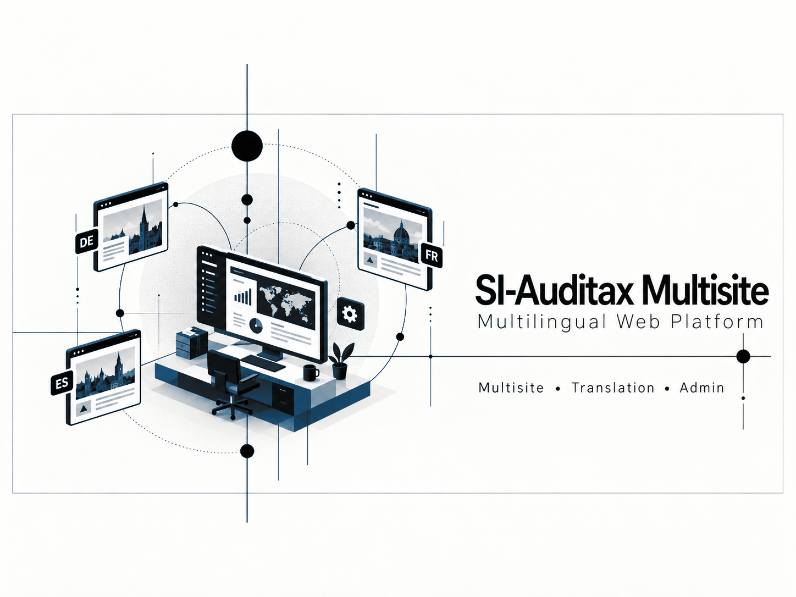

### A multilingual publishing platform with regional sites, governed content, translation review, and administrative workflows.

## Overview

The platform coordinates multiple regional websites from a shared content workflow. Editors prepare drafts, translations are generated and reviewed, and approved content is published to the correct regional experience.

## My Contributions

- Built coordinated public site, content API, and administrative editor experiences
- Designed draft, review, approval, backup, and publication states
- Integrated private AI-assisted translation with human review
- Kept tenant and regional context isolated throughout the workflow

## Project Highlights

- Global and regional publishing
- Human-reviewed multilingual content
- Draft and approval workflow
- Site-scoped administration

## System Architecture

A statically optimized web experience and an administrative React interface consume a private content API. Translation runs through an isolated inference service; only reviewed content reaches publication.

## Tech Stack

`Next.js` `React` `TypeScript` `Vite` `Node.js` `REST APIs` `Local LLM inference` `JSON content workflows`

## Results

- Separated editing from publication
- Enabled regional teams to share a platform without mixing content scopes
- Added reviewable AI assistance instead of automatic ungoverned publishing

## Screenshots

Additional sanitized product screenshots will be added when they can be shared without exposing private data or infrastructure.

## What I Learned

Multisite systems need explicit ownership, publication state, and fallback behavior. Translation quality improves when AI proposes changes but people retain final editorial control.

## Privacy and Ownership

> This public repository contains portfolio documentation only. Corporate source code, credentials, domains, infrastructure, and editorial data remain private.

## Contact

- [LinkedIn](https://www.linkedin.com/in/dev-ai-erick)
- [GitHub](https://github.com/DevDope)

---

This repository is maintained as a professional portfolio case study. No license to proprietary source code or private assets is granted.
